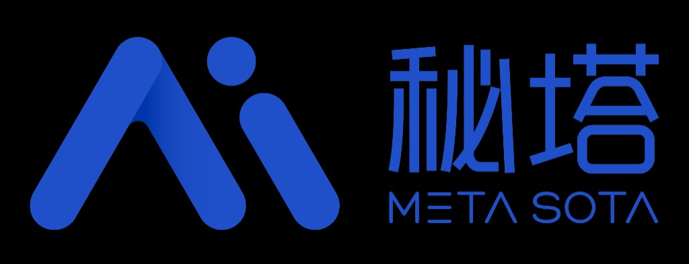
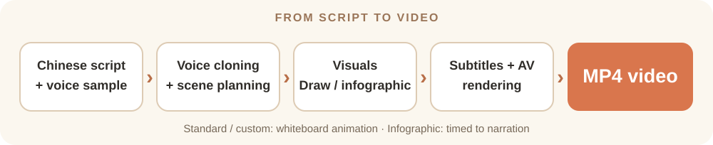
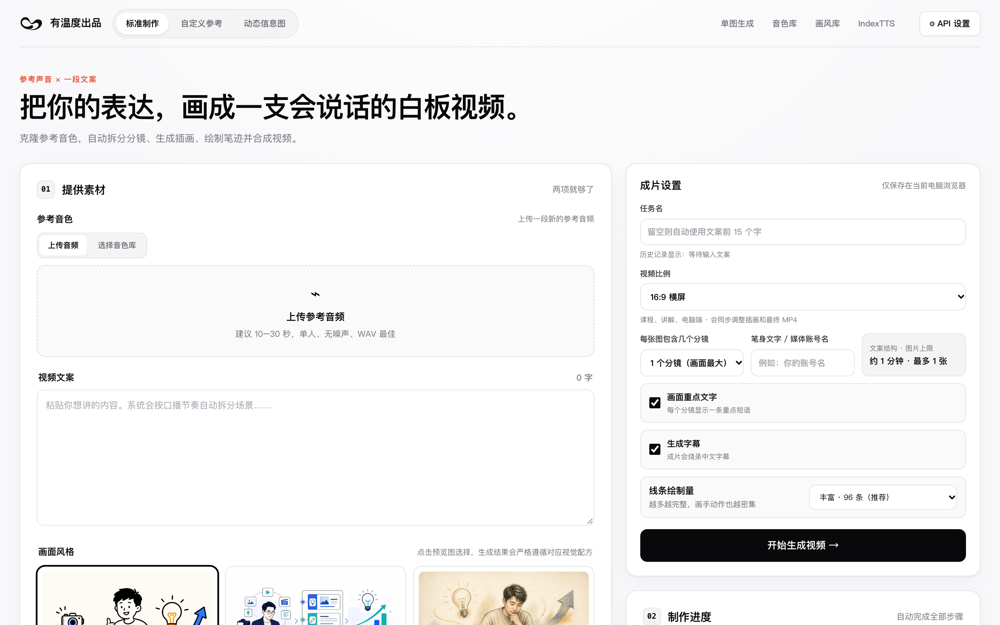
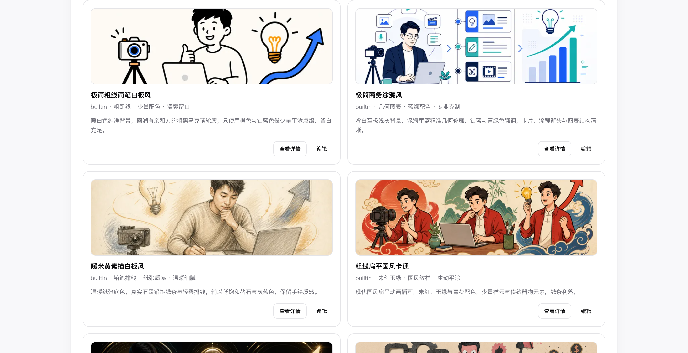
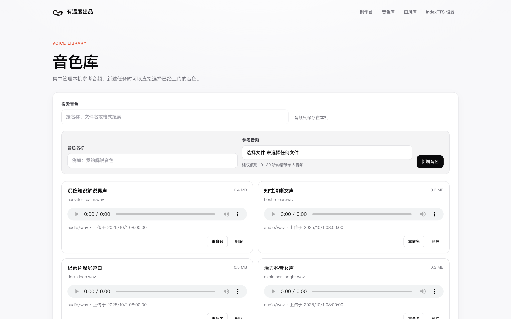

<div align="center">

# CS Board · Whiteboard Video Studio

**An open-source, local-first AI workbench for whiteboard animation and speech-timed infographic videos**

Upload a reference voice, paste a Chinese script, choose from **12 built-in visual templates** or attach character and style references—CS Board chains **local voice cloning, scene planning, AI illustration, object-aware hand-drawn animation, subtitles, and MP4 rendering** on your own machine.

[](README.md)
[](README.en.md)

[](https://github.com/ChenShuo2004/cs-board/stargazers)
[](LICENSE)
[](https://x.com/ChenshuoAI)
[](https://page.aiyouwendu.com/en/products/cs-board/)
[](https://gitcode.com/ChenShuo2004/cs-board)

[Quick Start](#quick-start) · [Highlights](#why-cs-board) · [Features](#whats-included) · [Screenshots](#workbench-previews) · [FAQ](#faq)

</div>

<br/>

<div align="center">
  <a href="examples/">
    
  </a>
  <p>
    <sub>
      🎬 <b>Real Whiteboard Output Example</b> (reference voice + script → object-aware stroke animation → subtitled MP4) ·
      <a href="examples/"><b>Browse Examples</b></a> ·
      <a href="README.md#界面预览"><b>Full Chinese Screenshots</b></a>
    </sub>
  </p>
</div>

### 3 Built-in Production Modes

| 🎨 Standard Mode | 🧩 Custom References | 📊 Dynamic Infographic |
| --- | --- | --- |
| Reference audio + Chinese script + 12 visual templates<br/><sub>Best for explainers, narrated stories, course promos</sub> | Add 1 style image + up to 5 characters (1–3 angles each)<br/><sub>Best for recurring IP and branded video series</sub> | Align real narration first, then reveal visuals on beat<br/><sub>Best for opinions, business analysis, teaching</sub> |

## Why CS Board?

- **Local voice cloning & dedicated resource libraries**: Connects to your own IndexTTS 2.5 (Gradio or FastAPI) server so voice samples stay local; includes dedicated **Voice Library** (`/voices`), **Style Library** (`/styles`), **IndexTTS Settings** (`/tts`), and a standalone **Image Generator** (`/image-generator`).
- **Object-aware stroke pacing & speech-timed infographics**: Adjacent strokes draw continuously by object rather than jumping across the frame; dynamic infographics follow real spoken phrase boundaries.
- **Checkpointed recovery & LAN collaboration**: Every stage saves checkpoints so render adjustments or single-frame rerolls skip upstream calls; all local data lives in `.webapp/` while LAN teammates can share the production queue.

---

## Sponsor

<table>
  <tr>
    <td width="220" align="center" valign="middle">
      <a href="https://metaso.cn/minimax-h3/?s=cs-board">
        
      </a>
    </td>
    <td valign="middle">
      <b>MiniMax H3 Video Generation API | MetaSOTA</b><br>
      Cost-effective MiniMax H3 video generation: <b>768P from ¥0.09/s, 2K from ¥0.15/s</b>. Native 2K with synced audio, <b>OpenAI-compatible API</b>, and <b>ComfyUI</b> support—no self-hosted GPU required.<br><br>
      🎁 Sign up via the <a href="https://metaso.cn/minimax-h3/?s=cs-board">CS Board partner link</a> for bonus credits and exclusive offers.
    </td>
  </tr>
</table>

---

## Pipeline

<div align="center">
  
</div>

## Quick Start

### Requirements

| Component | Requirement |
| --- | --- |
| **Operating system** | Windows 10/11, or macOS 15+ (required by the current Remotion renderer) |
| **Runtime** | Python 3.11+, Node.js 22.13+, FFmpeg and FFprobe on `PATH` |
| **Voice** | A reachable IndexTTS 2.5 Gradio or FastAPI service |
| **Models** | An OpenLux API key with text and image model access (separate image endpoint optional) |

### macOS

```bash
brew install python@3.13 node ffmpeg
git clone https://github.com/ChenShuo2004/cs-board.git
cd cs-board
python3.13 scripts/prepare_env.py
.venv/bin/python -m pip install -r webapp/requirements.txt
(cd web && npm ci)
./start-webapp.sh
```

### Windows PowerShell

```powershell
git clone https://github.com/ChenShuo2004/cs-board.git
cd cs-board
python scripts/prepare_env.py
.\.venv\Scripts\python.exe -m pip install -r webapp\requirements.txt
Push-Location web
npm ci
Pop-Location
.\start-webapp.ps1
```

Open [http://127.0.0.1:13000/](http://127.0.0.1:13000/). Quit **CSBoard.app** before starting the web version since both share ports `13000` and `18765`. In **API Settings**, configure and test your OpenLux key, text/image models, and IndexTTS endpoint, then upload a clean 10–30s voice sample and paste at least 10 Chinese characters. See the [Chinese setup guide](README.md#首次配置与资源页面) for optional image endpoints, output directories, and `pronunciation.yaml`.

---

## What's Included

| Feature | Details |
| --- | --- |
| **Voice library** | Store, audition, search, rename, and reuse local reference voices at `/voices`. |
| **Visual style library** | 12 built-in templates plus editable custom styles and preview images at `/styles`. |
| **Character references** | 1 style reference and up to 5 characters (1–3 images per character). |
| **Rendering controls** | `16:9`, `9:16`, or `1:1`; subtitle toggle, pen label, 4 drawing-density levels, and local key phrases. |
| **Job history & recovery** | Search, inspect, reuse, reroll a single image, cancel, or delete jobs with stage checkpoints. |
| **Image generator** | Generate and download PNGs outside the video queue at `/image-generator`. |

## Workbench Previews

<div align="center">
  
  <p><sub><b>Main Workbench</b>: Switch between Standard, Custom Reference, and Dynamic Infographic modes in one clean workspace</sub></p>
</div>

| Style Library (`/styles`) | Voice Library (`/voices`) |
| --- | --- |
| <br/><sub>Browse, edit, and inspect all 12 built-in & custom templates</sub> | <br/><sub>Manage and audition local reference voices</sub> |

For all 12 visual template thumbnails and additional screenshots, see the [Chinese README](README.md#12-套视觉模板).

---

## Repository & Local Data

```text
cs-board/
├── assets/          Drawing, cover, and visual style assets
├── docs/            Screenshots and semantic timing contract
├── examples/        Whiteboard animation examples
├── scripts/         Environment setup and rendering utilities
├── tests/           Queue, recovery, and timing tests
├── video_renderer/  Remotion dynamic infographic renderer
├── web/             React frontend
└── webapp/          FastAPI backend
```

Local configuration, voices, styles, job checkpoints, and rendered videos live in `.webapp/` (Git-ignored). Never share API keys or private audio in issues or commits; see [SECURITY.md](SECURITY.md).

## FAQ

<details>
<summary><b>1. Where are my voice samples, API keys, and outputs stored?</b></summary>

Everything stays locally under `.webapp/` by default. Remote text/image model calls only receive the inputs required for generation.

</details>

<details>
<summary><b>2. Can I tweak one frame or render setting without re-running the whole pipeline?</b></summary>

Yes. Each stage writes checkpoints, and Task Details lets you edit a single scene prompt and regenerate just that image, or reuse settings for a local re-render.

</details>

---

## License

[MIT License](LICENSE) · Maintained by [Warmth Visual](https://page.aiyouwendu.com/en/products/cs-board/) · [Chinese documentation](README.md) · [Follow @ChenshuoAI](https://x.com/ChenshuoAI)

<div align="center">

[](https://star-history.com/#ChenShuo2004/cs-board&Date)

</div>
