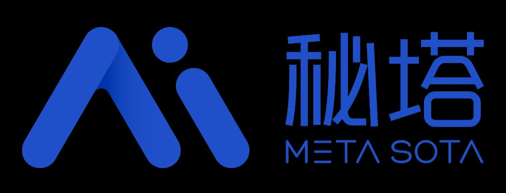
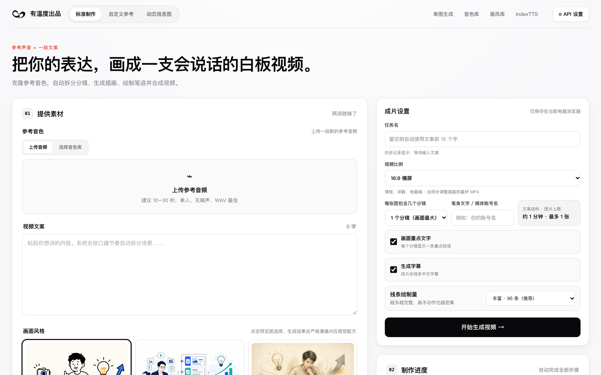
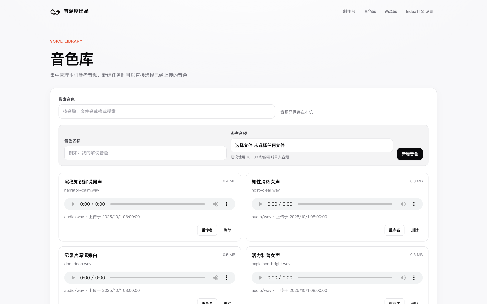
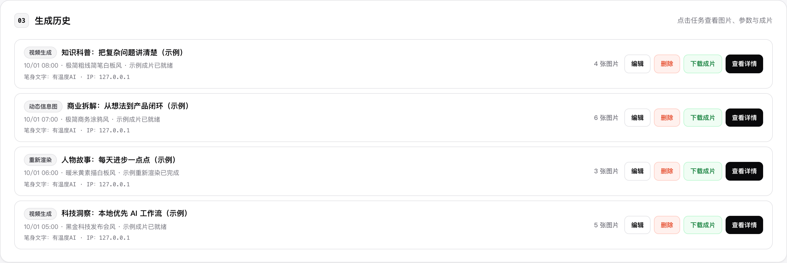
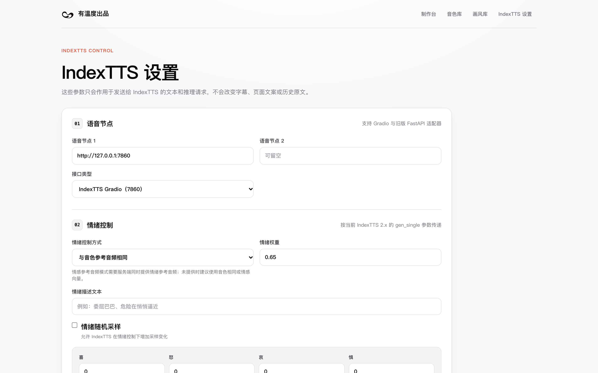
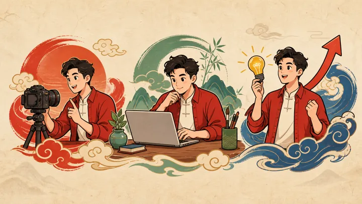
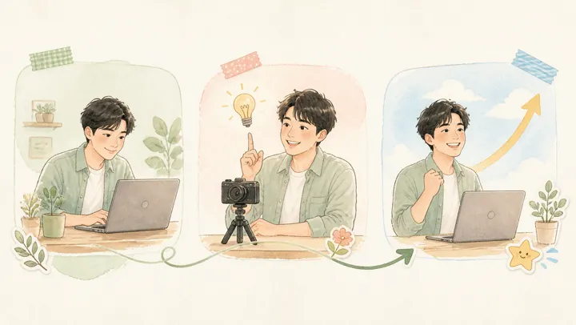

<div align="center">

# CS Board · 白板声画工坊

**开源、本地优先的 AI 白板声画与动态信息图视频制作工作台**

上传参考音频、粘贴中文文案，选择 **12 套内置视觉模板** 或提供人物与画风参考，一条链路串起 **本地音色克隆、内容拆解、AI 插画、对象级手绘动画、中文字幕与 MP4 合成**。  
素材、密钥、任务历史与成片默认保存在本机，同一局域网团队可共享制作队列。

[](README.md)
[](README.en.md)

[](https://github.com/ChenShuo2004/cs-board/stargazers)
[](LICENSE)
[](https://x.com/ChenshuoAI)
[](https://page.aiyouwendu.com/products/cs-board/)
[](https://gitcode.com/ChenShuo2004/cs-board)

[快速安装](#快速安装与启动) · [核心亮点](#核心亮点) · [界面预览](#界面预览) · [12 套视觉模板](#12-套视觉模板) · [首次配置](#首次配置与资源页面) · [开发验证](#开发验证) · [常见问题](#常见问题)

</div>

<br/>

<div align="center">
  <a href="examples/">
    
  </a>
  <p>
    <sub>
      🎬 <b>白板声画成片实拍</b>（参考声音 + 中文文案 → 对象级手绘笔迹动画 → 字幕与 MP4 合成） ·
      <a href="examples/"><b>查看示例素材</b></a> ·
      <a href="#界面预览"><b>查看工作台真实界面</b></a>
    </sub>
  </p>
</div>

### 三大制作模式直览

| 🎨 标准制作 · 模板直出成片 | 🧩 自定义参考 · 固定 IP 系列 | 📊 动态信息图 · 旁白语义对齐 |
| --- | --- | --- |
| 参考音频 + 中文文案 + 12 套视觉模板<br/><sub>适合知识讲解、故事口播、课程宣传</sub> | 额外加入 1 张画风图 + 最多 5 个角色（每人 1–3 张）<br/><sub>适合固定 IP、品牌视频、系列连载</sub> | 先对齐真实旁白短语时间表，再逐项展开图文<br/><sub>适合观点表达、商业分析、教学拆解</sub> |

## 核心亮点

- **本地音色克隆与独立资源管理**：接入自己的 IndexTTS 2.5（Gradio / FastAPI）服务，参考音频不离开本机；内置独立**音色库**（`/voices`）、**画风库**（`/styles`）、**IndexTTS 设置**（`/tts`）与**独立文生图工作台**（`/image-generator`）。
- **对象级手绘节奏 + 语义对齐信息图**：相邻笔画按对象连续绘制、按复杂度分配时长，减少跨对象跳笔；动态信息图先对齐真实旁白时间，再按说话节奏逐项呈现内容，避免画面抢跑。
- **全链路检查点与局域网共享队列**：配音、分镜、图片、分段视频与成片均有检查点，调整本地渲染或单独重绘某张图无需重跑上游；所有数据默认存本机 `.webapp/`，同一局域网多台设备可共享任务队列。

---

## 赞助商

<table>
  <tr>
    <td width="220" align="center" valign="middle">
      <a href="https://metaso.cn/minimax-h3/?s=cs-board">
        
      </a>
    </td>
    <td valign="middle">
      <b>MiniMax H3 视频生成 API｜秘塔科技</b><br>
      秘塔科技提供高性价比的 MiniMax H3 视频生成服务：<b>768P 仅 0.09 元/秒，2K 仅 0.15 元/秒</b>。支持原生 2K、音画同步，API 兼容 <b>OpenAI 协议</b>，同时支持 <b>ComfyUI</b>，无需自行部署 GPU。<br><br>
      🎁 通过 <a href="https://metaso.cn/minimax-h3/?s=cs-board">cs-board专属链接注册</a>，即可领取赠送额度及专属优惠。
    </td>
  </tr>
</table>

---

## 工作流程

<div align="center">
  
</div>

## 快速安装与启动

### 环境要求

| 组件 | 要求 |
| --- | --- |
| **操作系统** | Windows 10/11（PowerShell 一键脚本），或 macOS 15+（Intel / Apple Silicon，Remotion 渲染要求） |
| **基础运行时** | Python 3.11+、Node.js 22.13+、FFmpeg 与 FFprobe（已加入系统 `PATH`） |
| **语音服务** | 可访问的 IndexTTS 2.5 服务（Gradio 或 FastAPI） |
| **模型渠道** | OpenLux API Key（具备文本模型与图片模型权限；图片接口支持单独配置） |

先克隆仓库并确认音视频依赖可用（后续命令均在仓库根目录执行）：

```bash
git clone https://github.com/ChenShuo2004/cs-board.git
cd cs-board
ffmpeg -version && ffprobe -version
```

### 方式一：macOS

```bash
# 1. 如未安装基础运行时，可通过 Homebrew 安装
brew install python@3.13 node ffmpeg

# 2. 初始化虚拟环境与前后端依赖（首次执行）
python3.13 scripts/prepare_env.py
.venv/bin/python -m pip install -r webapp/requirements.txt
(cd web && npm ci)

# 3. 一键启动工作台
./start-webapp.sh
```

> [!TIP]
> 国内网络安装 Python 依赖较慢时，可对安装命令临时指定清华源：
> ```bash
> PIP_INDEX_URL=https://pypi.tuna.tsinghua.edu.cn/simple python3.13 scripts/prepare_env.py
> PIP_INDEX_URL=https://pypi.tuna.tsinghua.edu.cn/simple .venv/bin/python -m pip install -r webapp/requirements.txt
> ```
> 网页版与 macOS DMG 共用 `13000` 和 `18765` 端口，启动网页版前请先退出 **CSBoard.app**。动态信息图首次运行会自动准备 Remotion 与 Whisper.cpp 所需资源。

### 方式二：Windows（PowerShell）

```powershell
# 1. 初始化虚拟环境与前后端依赖（首次执行）
python scripts/prepare_env.py
.\.venv\Scripts\python.exe -m pip install -r webapp\requirements.txt
Push-Location web
npm ci
Pop-Location

# 2. 一键启动工作台
.\start-webapp.ps1
```

启动后自动打开 [http://127.0.0.1:13000/](http://127.0.0.1:13000/)，同一局域网设备也可通过脚本输出的地址访问。

---

## 首次配置与资源页面

打开右上角 **API 设置**，填写并测试以下配置：

1. **OpenLux API Key**：仅保存在本机 `.webapp/config.json`，页面不回显完整密钥。
2. **文本模型**：默认 `gpt-5`，用于拆解文案、生成分镜或信息图结构。
3. **图片模型**：默认 `gpt-image-2`，用于生成插画。
4. **图片接口地址 / 图片 API Key（可选）**：留空时沿用文本模型服务入口；若文本与图片来自不同供应商，可单独配置地址或密钥。
5. **IndexTTS 地址与接口类型**：Gradio 默认 `http://127.0.0.1:7860`，FastAPI 通常为 `8000` 端口。
6. **视频输出目录（可选）**：设置后自动将最终 MP4 复制到指定目录（支持 macOS 系统目录选择器），中间素材与检查点仍保留在 `.webapp/jobs/<任务 ID>/`。

测试连接成功后，上传 10–30 秒清晰单人参考音频、粘贴至少 10 字中文文案，选择制作模式与视觉模板即可开始。

### 四大独立资源页面

| 页面 | 路由 | 核心能力 |
| --- | --- | --- |
| **音色库** | `/voices` | 按名称/文件名/格式搜索、分页试听、新增、重命名与删除；提交任务时会复制音色到任务目录，后续修改不影响历史任务。 |
| **画风库** | `/styles` | 统一浏览内置与自定义画风，支持搜索、分页、编辑配方、上传预览图，点击「查看详情」查看完整字段。 |
| **IndexTTS 设置** | `/tts` | 单独管理节点、情绪控制方式、八维情绪向量、情绪文本及 `top_p` / `top_k` / `temperature` / `num_beams` 等推理参数。 |
| **文生图工作台** | `/image-generator` | 复用 API 设置与共享画风库独立出图并下载 PNG（仅配图片 Key 也可使用）；最近 4 张保留在当前会话中。 |

<details>
<summary><b>TTS 文本预处理与多音字配置（pronunciation.yaml）</b></summary>

系统仅处理发送给 IndexTTS 的文本，分镜、页面内容与字幕均保留原文。生成语音前会自动保护 `GPT-5`、`Qwen3-TTS` 等术语，并按上下文转换连字符（如 `3-5` →「3到5」，`-2` →「负2」）。

多音字短语写在仓库根目录 `pronunciation.yaml` 中，下一次生成自动生效：

```yaml
phrases:
  - phrase: 银行
    char: 行
    pinyin: HANG2
```

</details>

---

## 核心能力

| 能力 | 说明 |
| --- | --- |
| **本地音色克隆与音色库** | 接入自有 IndexTTS 2.5 服务，参考音频不离本机；支持多条音色管理与直接复用。 |
| **12 套内置视觉模板** | 从极简白板、国风、手账到黑金科技与赛博霓虹，内置风格可编辑配方，并支持新增自定义画风。 |
| **固定 IP 人物与画风参考** | 支持 1 张风格参考图 + 最多 5 个角色（每人 1–3 张多角度参考图），按文案自然编排角色。 |
| **语义对齐动态信息图** | 先将真实旁白对齐为短语时间表，再按说话时间逐项呈现，详见 [语义时间契约](docs/semantic-timing-contract.md)。 |
| **中文重点词与多画幅控制** | 支持 `16:9` / `9:16` / `1:1`、字幕开关、笔身账号名、4 档线条绘制量、每图 1–4 分镜与本地 4–10 字重点词叠加。 |
| **任务复用、局部重绘与断点恢复** | 全流程检查点复用；支持按关键字搜索历史任务、复用整套参数，或单独修改提示词重绘某一张图。 |
| **独立文生图与局域网协作** | `/image-generator` 独立出图下载 PNG；同一局域网多台电脑共享队列与历史，个人偏好留在各自浏览器。 |

---

## 界面预览

以下为新版极简工作台真实界面截图（演示数据不含密钥与真实业务任务）。

<div align="center">
  
  <p><sub><b>主制作台</b>：顶部一键切换标准制作 / 自定义参考 / 动态信息图，左侧上传音色、输入文案与选择画风，右侧控制比例、字幕与线条绘制量</sub></p>
</div>

| 画风库 · 12 套模板与配方管理（`/styles`） | 音色库 · 本地参考音频管理（`/voices`） |
| --- | --- |
| <br/><sub>内置与自定义画风统一浏览、编辑与详情查看</sub> | <br/><sub>集中管理本机参考音频，新建任务直接选择</sub> |

| 生成历史 · 搜索分页与成片下载 | 文生图工作台 · 复用画风独立出图（`/image-generator`） |
| --- | --- |
| <br/><sub>按任务名/文案/画风/状态搜索，支持取消、编辑与删除</sub> | <br/><sub>共享画风与 API 配置，独立生成并下载 PNG</sub> |

<details>
<summary><b>展开查看：IndexTTS 语音参数设置（<code>/tts</code>）</b></summary>



</details>

---

## 12 套视觉模板

选择模板会同步影响插画的配色、线条、材质与构图；实际人物、物体和场景随文案动态生成。

| 模板 | 预览 | 画面特征 | 推荐内容 |
| --- | --- | --- | --- |
| **极简粗线简笔白板风** |  | 粗黑线、少量配色、清爽留白 | 知识讲解、个人表达、复盘总结 |
| **极简商务涂鸦风** |  | 几何图表、蓝绿配色、专业克制 | 产品介绍、商业分析、项目汇报 |
| **暖米黄素描白板风** |  | 铅笔排线、纸张质感、温暖细腻 | 人物故事、个人成长、品牌叙事 |
| **粗线扁平国风卡通** |  | 朱红玉绿、国风纹样、生动平涂 | 传统文化、国风品牌、中文创意 |
| **爆款高热吸睛风** |  | 高饱和、强对比、夸张动势 | 短视频开场、强观点、热点表达 |
| **黑金科技发布会风** |  | 黑金光效、科技舞台、高级权威 | AI、科技产品、发布会 |
| **清新治愈手账风** |  | 柔和水彩、低饱和配色、生活手账感 | 情感、生活方式、自我成长 |
| **复古报纸拼贴风** |  | 撕纸拼贴、半色调、编辑杂志感 | 深度观点、文化内容、案例复盘 |
| **纸感隐喻拼贴风** |  | 手工剪纸、观点隐喻、高级克制 | 价值观、关系、流程、复杂观点 |
| **漫画墨线解释风** |  | 漫画墨线、半调网点、概念机制 | 原理讲解、机制拆解、商业洞察 |
| **3D黏土趣味风** |  | 黏土材质、玩具比例、温暖可爱 | 亲子教育、轻量品牌、趣味科普 |
| **赛博霓虹漫画风** |  | 霓虹青紫、漫画速度线、未来感 | AI 趋势、数码科技、年轻化观点 |

---

## 开发验证

```bash
# macOS / Linux
(cd web && npm test)                                 # 前端构建与页面验证
.venv/bin/python -m unittest discover -s tests -v    # 后端队列、断点恢复与时间线测试
(cd video_renderer && npm run build)                 # Remotion 类型检查
```

<details>
<summary><b>Windows PowerShell 验证命令</b></summary>

```powershell
Push-Location web; npm test; Pop-Location
.\.venv\Scripts\python.exe -m unittest discover -s tests -v
Push-Location video_renderer; npm run build; Pop-Location
```

</details>

---

## 项目结构与本地数据

```text
cs-board/
├── assets/               # 画笔、视觉风格、封面与参考素材
├── docs/                 # 界面截图、动态信息图语义时间契约文档
├── examples/             # 白板动画示例素材
├── scripts/              # 环境准备、白板渲染、时间线与维护脚本
├── tests/                # 队列、恢复与语义时间测试
├── video_renderer/       # Remotion 动态信息图渲染器
├── web/                  # React 前端
├── webapp/               # FastAPI 后端
├── pronunciation.yaml    # TTS 多音字发音规则
├── start-webapp.ps1      # Windows 一键启动
└── start-webapp.sh       # macOS / Linux 一键启动
```

所有本地配置、音色、画风、检查点与成片均保存在 `.webapp/`（已加入 `.gitignore`），配置视频输出目录后成片会同步另存为 `whiteboard-<任务 ID>.mp4`。切勿在 Issue、日志或提交中公开 API Key 或参考音频；安全问题请按 [SECURITY.md](SECURITY.md) 私下报告。

---

## 常见问题

<details>
<summary><b>1. 我的参考音频、API Key 和历史成片保存在哪里？</b></summary>

全部默认保存在本机 `.webapp/` 目录下（`config.json`、`voices/`、`styles/`、`jobs/`），不会上传至第三方账号服务器。调用远程文本或图片模型时，仅发送该次生成所需的提示词与参考素材。

</details>

<details>
<summary><b>2. 局部画面不满意或想改字幕/节奏，需要重新花钱调模型吗？</b></summary>

不需要。配音、分镜、图片、分段视频与成片均有检查点；在「任务详情」中可单独修改某一张图片的提示词并只重绘该图，或复用设置直接重新本地渲染。

</details>

<details>
<summary><b>3. 删除历史任务会连带清理哪些文件？</b></summary>

排队中或运行中的任务需先取消。删除已结束任务会清理该任务在 `.webapp/jobs/<任务 ID>/` 下的本地素材、检查点与成片；若配置了外部视频输出目录，也会一并清理对应最终 MP4。

</details>

<details>
<summary><b>4. 网页版提示端口被占用怎么办？</b></summary>

网页版与 macOS 桌面包 **CSBoard.app** 共用 `13000`（前端）与 `18765`（后端）端口。先退出桌面应用后再执行 `./start-webapp.sh` 即可。

</details>

---

## 贡献与许可证

- 欢迎提交 Issue 或 Pull Request；涉及渲染逻辑的改动，请附真实素材下的时序、遮罩保护与最终成片验证说明。
- 本项目采用 [MIT License](LICENSE) 开源 · 由 [有温度AI](https://page.aiyouwendu.com/products/cs-board/) 团队制作维护。

<div align="center">

[](https://star-history.com/#ChenShuo2004/cs-board&Date)

</div>
